<div align="center">

# 🎓 Lab08-DAM — Gestión de Alumnos
### Laboratorio de ListViews, ListTiles, Listas y Mapas, Rutas, Tema Global y Cards


</div>

---

## 📖 Descripción

App Flutter de gestión de alumnos con 5 pantallas (Login, Menú, Listar Alumnos, Registrar Alumno, Perfil), construida para demostrar el uso de `ListView`, `ListTile`, listas y mapas, rutas con nombre, tema global y `Card`. Los datos viven en memoria (sin backend) y se comparten entre pantallas mediante una lista global.


## 🖼️ Pantallas

<table>
<tr>
<td align="center" width="20%">

**1. Login**
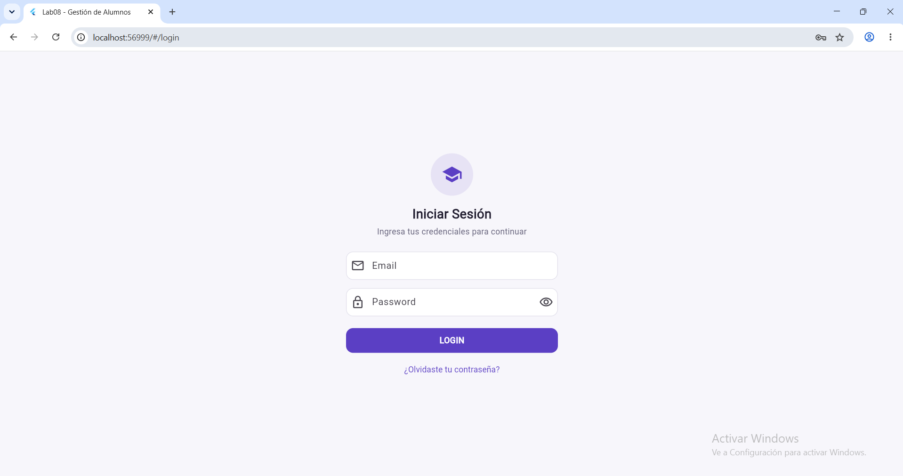
Formulario simulado de inicio de sesión, con `TextField` para email/contraseña y validación de campos vacíos.

</td>
<td align="center" width="20%">

**2. Menú**
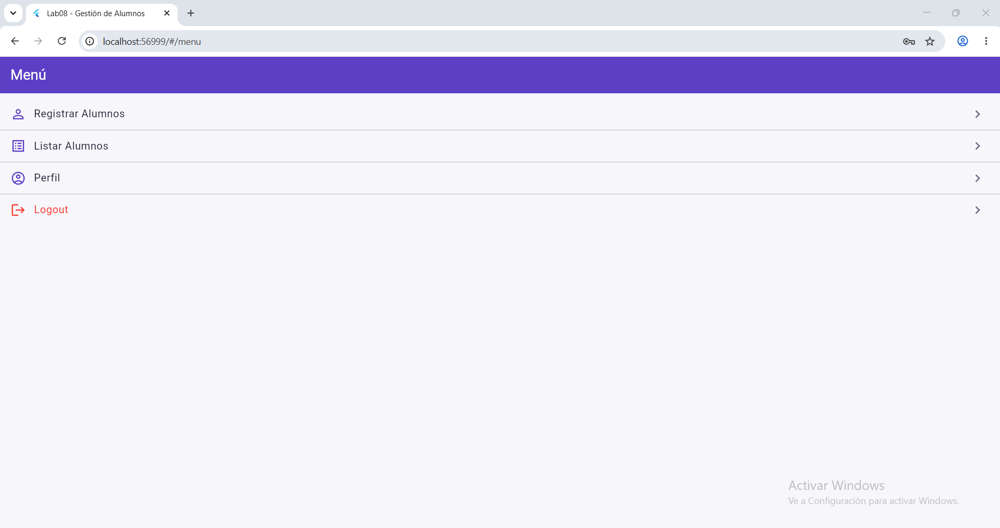
`ListView.separated` con 4 `ListTile` generados desde una lista de mapas (ícono, título, ruta).

</td>
<td align="center" width="20%">

**3. Listar Alumnos**
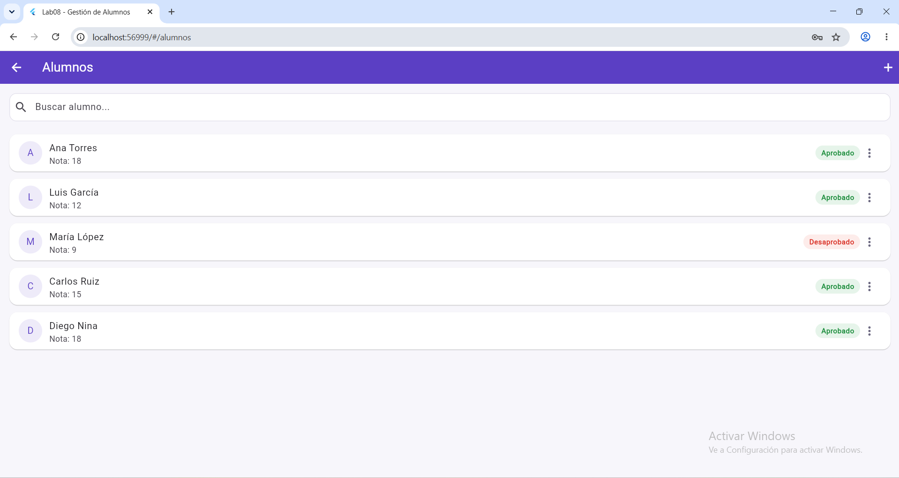
`ListView.builder` + `Card` por cada alumno, con etiqueta Aprobado/Desaprobado calculada según la nota.

</td>
<td align="center" width="20%">

**4. Registrar Alumno**
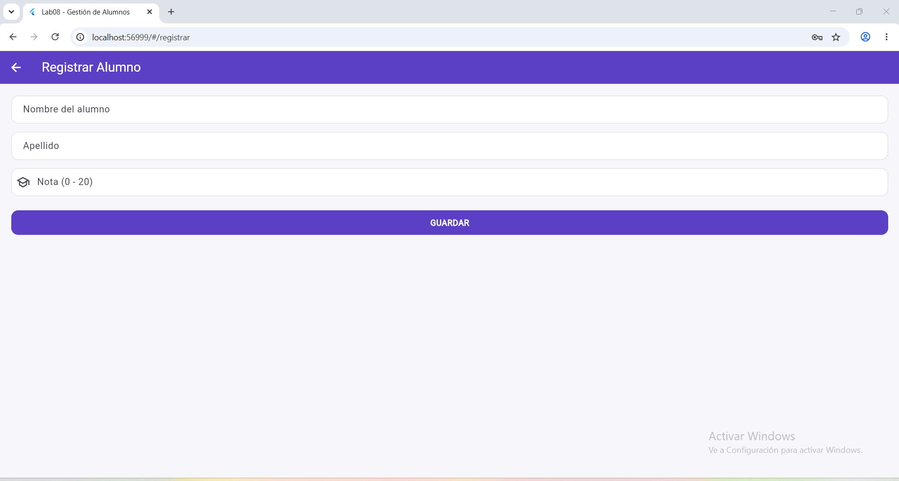
Formulario que agrega un alumno a la lista global y valida que la nota esté entre 0 y 20.

</td>
<td align="center" width="20%">

**5. Perfil**
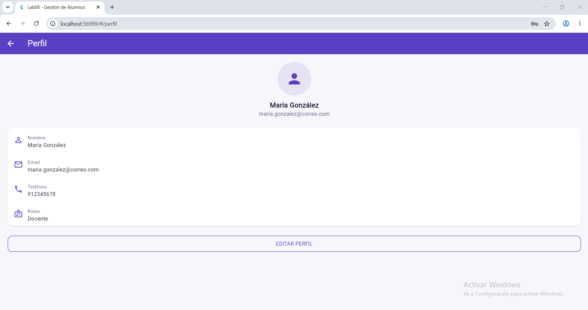
Datos del usuario mostrados en `Card` + `ListTile`, generados también desde una lista de mapas.

</td>
</tr>
</table>

## 🧩 Capacidades evaluadas y dónde se aplican

| Capacidad | Pantalla(s) | Archivo |
|---|---|---|
| Tema global | Toda la app | `theme/app_theme.dart` |
| Rutas con nombre | Navegación entre las 5 pantallas | `routes/app_routes.dart`, `main.dart` |
| ListView + ListTile | Menú, Listar Alumnos, Perfil | `menu_screen.dart`, `listar_alumnos_screen.dart`, `perfil_screen.dart` |
| Cards | Listar Alumnos, Perfil | `listar_alumnos_screen.dart`, `perfil_screen.dart` |
| Listas y Mapas | Datos de alumnos y perfil | `data/alumnos_data.dart` |

## 💡 Código nuevo frente a laboratorios anteriores

Estas 7 capacidades no aparecían en GLAB-S02, GLAB-S03 ni en el Calendario, y son el aporte propio de este laboratorio:

### 1. `StatefulWidget` + `setState`
`lib/screens/listar_alumnos_screen.dart`
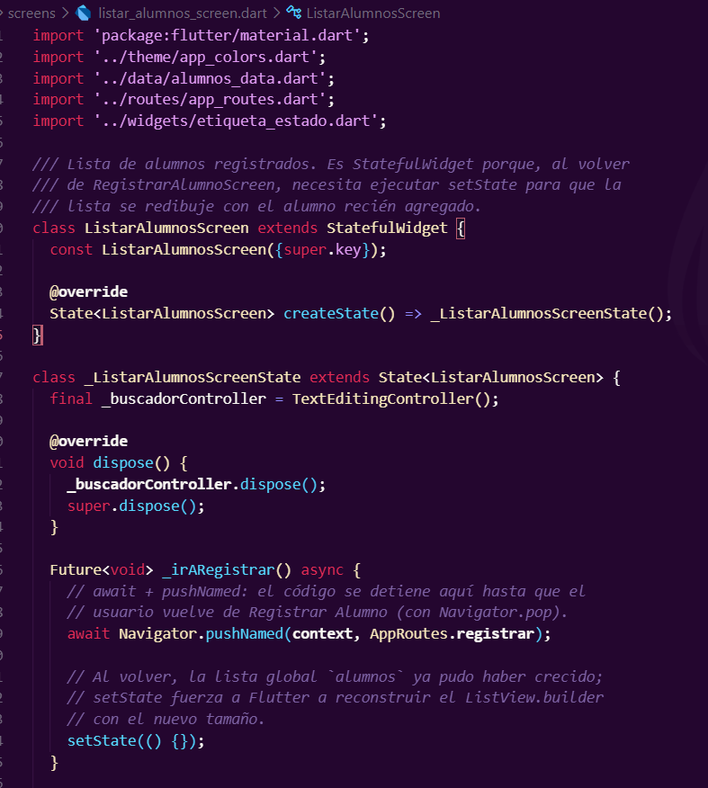

A diferencia de los widgets `Stateless` usados hasta el Calendario, esta pantalla necesita recordar cuándo redibujarse. `setState({})` le avisa a Flutter que la lista global cambió.

### 2. `TextEditingController` + `dispose()`
`lib/screens/login_screen.dart`
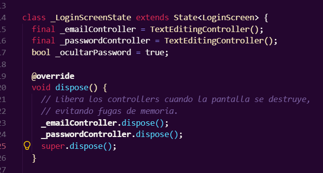

Los controllers capturan lo escrito en los `TextField`. `dispose()` libera esos recursos al destruirse la pantalla, evitando fugas de memoria.

### 3. `Navigator.pushReplacementNamed`
`lib/screens/login_screen.dart`
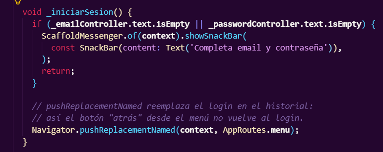

Reemplaza el login en el historial de navegación: el botón "atrás" desde el menú no regresa al login.

### 4. `Navigator.pushNamedAndRemoveUntil`
`lib/screens/menu_screen.dart`
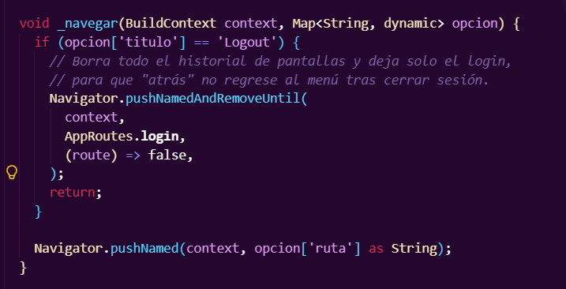

Borra todo el historial de pantallas al cerrar sesión, dejando solo el login.

### 5. Rutas con nombre (`MaterialApp.routes`)
`lib/routes/app_routes.dart`
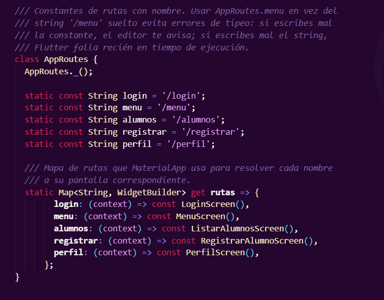

Centraliza la navegación en constantes (`AppRoutes.menu`) en vez de strings sueltos, evitando errores de tipeo no detectados por el compilador.

### 6. `ListView.builder` + `Card` + `ListTile`
`lib/screens/listar_alumnos_screen.dart`
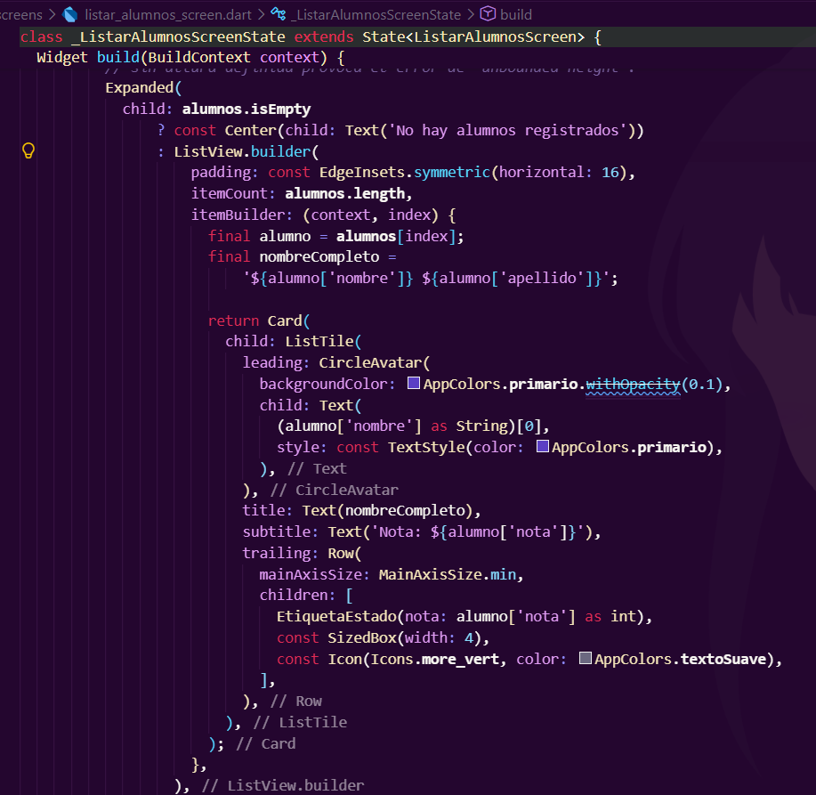

Genera dinámicamente una `Card` con `ListTile` por cada alumno de la lista global.

### 7. Validación con `int.tryParse`
`lib/screens/registrar_alumno_screen.dart`
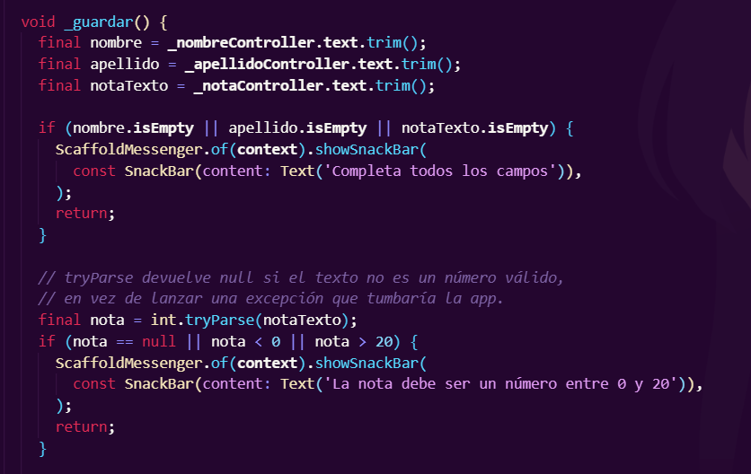

`tryParse` devuelve `null` en vez de lanzar una excepción si el texto no es un número válido, permitiendo mostrar un mensaje de error controlado.

## 🛠️ Stack tecnológico

| Tecnología | Uso |
|---|---|
| **Flutter** (Web) | Framework de UI |
| **Dart 3** | Lenguaje |
| **Material 3** | Sistema de diseño base |
| Sin paquetes externos | Todo lo evaluado viene en Flutter base |

## 📂 Estructura del proyecto

```
lib/
├── main.dart                        # MaterialApp + tema global + rutas
├── theme/
│   ├── app_theme.dart                # ThemeData completo
│   └── app_colors.dart               # Paleta centralizada
├── data/
│   └── alumnos_data.dart             # List<Map> de alumnos + perfil
├── routes/
│   └── app_routes.dart               # Constantes y mapa de rutas
├── screens/
│   ├── login_screen.dart
│   ├── menu_screen.dart
│   ├── listar_alumnos_screen.dart
│   ├── registrar_alumno_screen.dart
│   └── perfil_screen.dart
└── widgets/
    └── etiqueta_estado.dart          # Etiqueta Aprobado/Desaprobado
```

## 🚀 Cómo ejecutarlo

```bash
flutter pub get
flutter run -d chrome
```

---

<div align="center">

**Diego Nina Malqui**
Curso: Desarrollo de Aplicaciones Multiplataforma · Carrera: Diseño y Desarrollo de Software
Tecsup · Sección: `[completar]`

</div>